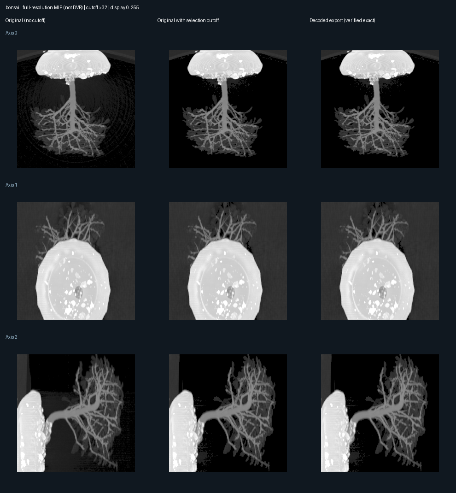
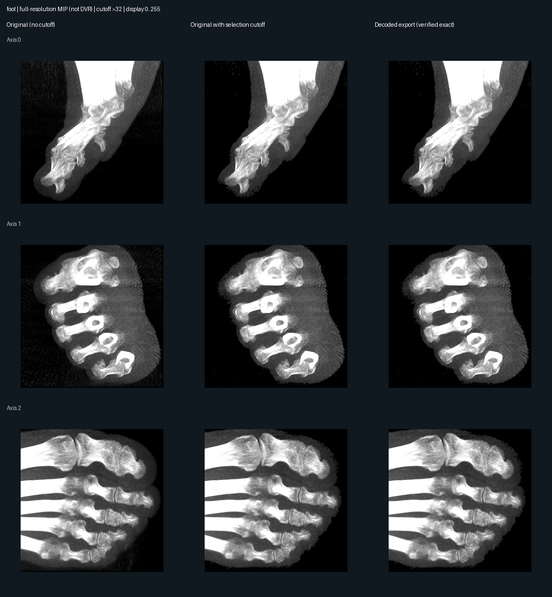
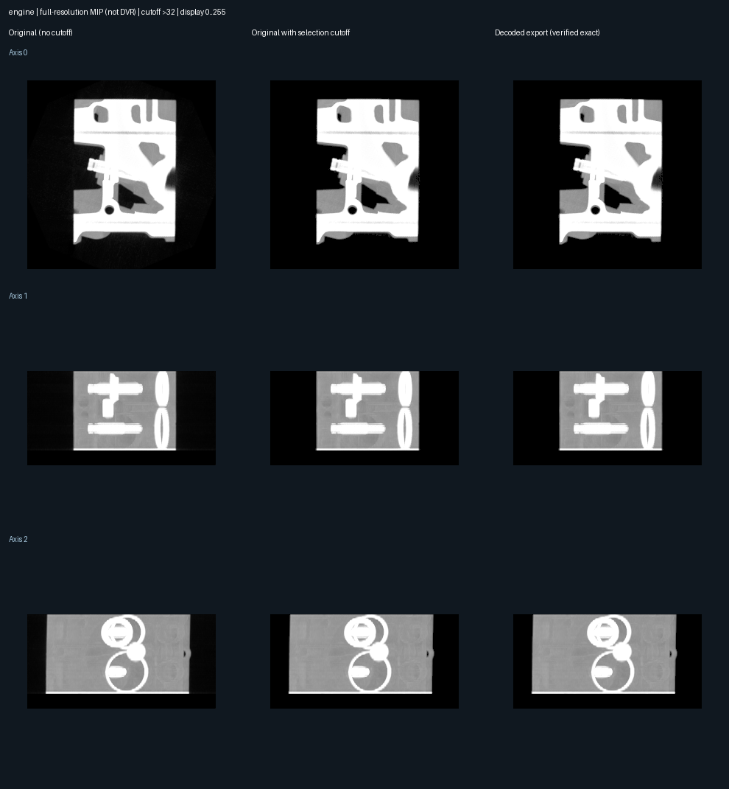
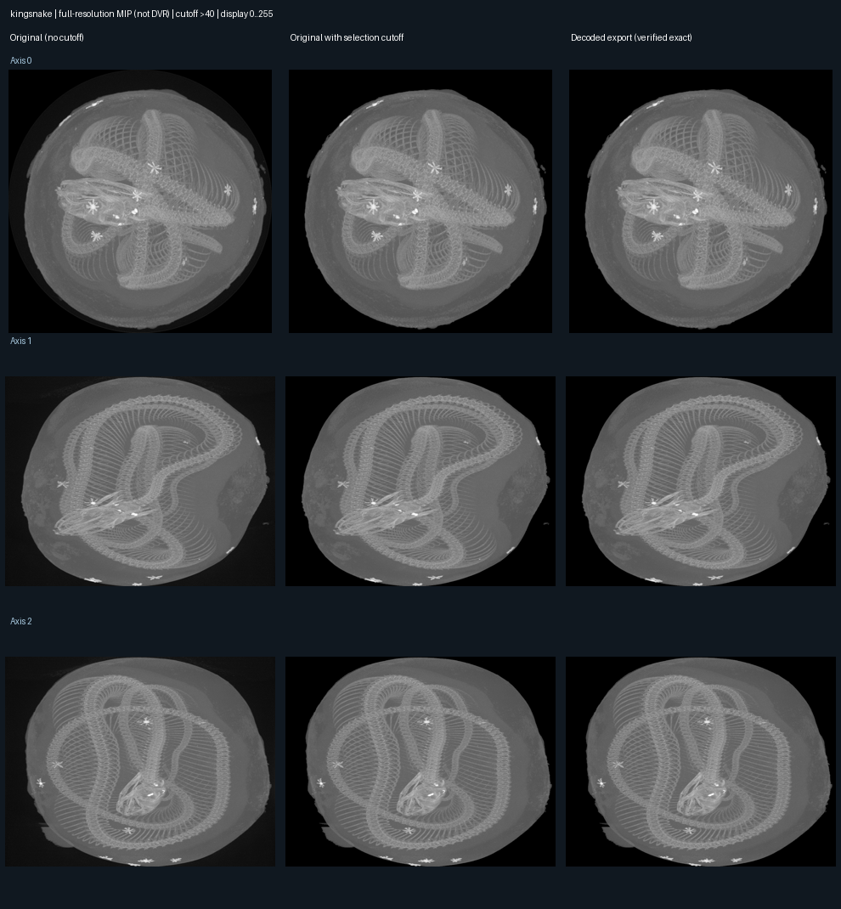
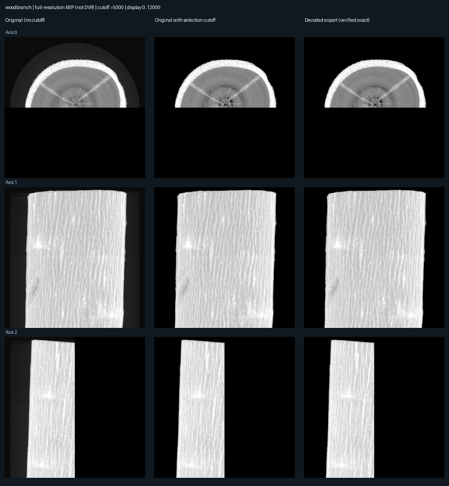

# VolumeSegmenter

体数据处理与 WebGL2 渲染的 **Proof of Concept**：把 RAW 拆成保留原始坐标的小块，筛选目标体素，组成可独立选择的逻辑组，比较原始数据和组合后的体积、GPU 用量及渲染耗时。

**筛选与紧密存储能减少用量，但不保证渲染更快。** 保留的体素值和坐标不变；筛选本身有损，尚不能断言被删除的数据都不重要。逻辑组是空间/强度候选区域，不是经过验证的组织标签。

## 1. 运行已有样例

以下命令都在**项目根目录**执行，不要先进入 web 或 pipeline 子目录。

~~~bash
cd /Users/jialinghuang/VolumeSegmenter

# 首次安装；已有 .venv 时只需激活
python3 -m venv .venv
source .venv/bin/activate
pip install -r requirements-lock.txt

# 下载并生成 Bonsai、Foot、Engine；已有输出时不要重复执行
python -m pipeline.prepare_examples

# 必须在项目根目录启动，让前端能访问实验数据
python -m http.server 8765 --bind 127.0.0.1
~~~

打开 [原始数据 / 分组体积对比](http://127.0.0.1:8765/web/compare_volumes.html?dataset=bonsai)，或 [首页](http://127.0.0.1:8765/)。

- 下拉菜单切换样例；菜单存在不代表本机已生成该样例的数据。
- 拖动旋转、滚轮缩放，两个交互视图同步。
- 展开「共享颜色 / 不透明度」编辑 transfer function，颜色代表强度。
- 展开「逻辑分组与体积用量」选择组，查看各组大小、组合总量和 GPU 用量。
- 选择变化会释放旧纹理，再上传所选组，不只是隐藏。
- FPS 是双视图同时运行时的频率；正式速度对比使用独立页面的 GPU 计时。
- Woodbranch 左侧是注明来源的外部静态参考图，不能同步旋转或逐像素核对。
- 停止服务器：在 Terminal 按 Ctrl+C。

需要 Python 3.12+；Windows 激活环境使用 .venv\Scripts\activate。

大型下载和生成文件没有提交到 Git。仓库包含测量 JSON、图表、代码和复现命令。Kingsnake / Woodbranch 见 [大体数据指南](docs/LARGE_VOLUMES.md)，原有 Skull 见 [SLIC 与逻辑体数据指南](docs/SUPERVOLUMES.md)。

## 2. 处理自己的 RAW

当前是**离线处理文件，再让前端读取结果**，不是网页上传。把文件放到 data/my_volume.raw，先确认：

| 参数 | 要求 |
| --- | --- |
| W、H、D | 宽、高、深；RAW 本身不包含尺寸 |
| 类型 | uint8 或小端 uint16，每体素分别为 1 / 2 字节 |
| 排列 | X 最快，其次 Y，最后 Z |
| 间距 | XYZ 的实际体素间距；未知可先填 1，但不代表真实比例 |
| 文件大小 | 必须等于 W × H × D × 每体素字节数 |

以下是 **256³ uint8** 示例，需要替换成自己的参数：

~~~bash
source .venv/bin/activate

python - <<'PY'
from pipeline.large_volume import RawSource, export
from pipeline.group_large_volume import group_volume

source = RawSource(
    path="data/my_volume.raw",
    shape=(256, 256, 256),       # D、H、W，注意顺序
    dtype="uint8",              # 小端 uint16 使用 "<u2"
    spacing=(1, 1, 1),          # Z、Y、X，注意顺序
    name="my_volume",
)

export(
    source,
    output="experiments/large-volumes/my_volume32",
    cutoff=32,                 # 保留原始值 >32
    save_original=True,        # 另存完整参考，会增加磁盘占用
)

group_volume(
    directory="experiments/large-volumes/my_volume32",
    output="experiments/large-volumes/my_volume-groups",
    edges=[96, 160],            # 小块中位强度分段，按数据调整
)
PY

python -m pipeline.verify_large_volume experiments/large-volumes/my_volume32
python -m pipeline.verify_large_groups \
  experiments/large-volumes/my_volume-groups \
  experiments/large-volumes/my_volume32
~~~

阈值和分段边界不是通用设置。edges 必须递增、互不重复，大于 cutoff 且不超过数据最大值。每次使用**空的新输出目录**，程序不会覆盖旧结果。

启动服务器后打开 [自定义 RAW 渲染页](http://127.0.0.1:8765/web/large_volume.html?manifest=../experiments/large-volumes/my_volume-groups/metadata.json)。它支持原始 / 组合体切换、颜色预设、旋转和三视角速度测量。

自定义数据**不会自动加入预设下拉菜单**。交互式分组对比当前配置了五组公开样例及原有 Skull。

网页移到 web 后，manifest、input、base 参数相对于网页解析。例如根目录下的实验路径写成 ../experiments/...，输入写成 ../data/...。

## 3. Pipeline 流程

~~~mermaid
flowchart TD
    A[RAW + 尺寸 / 类型 / 间距] --> B[分批读取]
    B --> C[显式阈值筛选]
    C --> D[小块裁剪 + 原始空间坐标]
    D --> E[中位强度分段 + 六邻接组件]
    E --> F[逻辑组引用小块]
    F --> G[密集裁剪或占用位图编码]
    G --> H[样本值 / 位图 / 索引 / 元数据]
    H --> I[独立解码验证]
    I --> J[上传所选组并释放旧纹理]
    J --> K[WebGL2 渲染 / 参考对比 / GPU 计时]
~~~

1. **读取**：按 RAW 切片批次或 OME-Zarr 数据块处理，避免完整输入和标签数组同时驻留。
2. **筛选**：大数据路径使用显式强度阈值；这是删除数据的有损步骤。
3. **拆块**：每块只保存自己的局部范围，并记录原始坐标，不扩展回完整 WLH。
4. **分组**：按保留体素的中位强度分段，同段的六邻接小块合并。最大九个组件单列，其余明确标为「零散区域合集」。每块只属于一组，分组不会再删除体素。网格块连通不保证体素级连通。
5. **编码**：自动选较小的密集裁剪或位图存储。位图用每 32 个位置的占用信息和偏移恢复坐标，避免保存块内空白，不量化或额外删除已保留体素。
6. **验证**：检查哈希、坐标、所有权、逐块数值、直方图和投影；可加载完整参考时再比较渲染图像。
7. **渲染**：逻辑父 AABB 不生成大纹理。只上传所选组，但仍有固定页表开销；尚未实现按需分页缓存或 LOD。

原有 Skull 路径是 **SLIC 候选区域 → 图选择 → 稀疏砖块 → 逻辑组**，保留用于对照。新的大数据路径是小块图分组，不是跨块 SLIC。

## 4. 目录与文件职责

~~~text
VolumeSegmenter/
├── README.md                   项目入口、使用方法、结果
├── index.html                  静态服务器首页
├── requirements*.txt           依赖范围及锁定版本
├── pipeline/                   Python 处理与实验代码
├── web/                        HTML / JavaScript 前端
├── data/                       输入 RAW 与历史 Skull 分块
├── configs/                    Skull 候选筛选和种子配置
├── tests/                      数值、坐标及存储正确性测试
├── docs/                       方法、复现指南、历史截图
└── experiments/                生成数据、测量记录与历史基线
~~~

### Python：pipeline/

统一从根目录使用 python -m pipeline.模块名 运行。

| 文件 | 职责 / 所在阶段 |
| --- | --- |
| [large_volume.py](pipeline/large_volume.py) | RAW / OME-Zarr 分批读取、筛选、裁剪，输出样本、页表、元数据和参考 MIP |
| [group_large_volume.py](pipeline/group_large_volume.py) | 强度与邻接分组，选择密集 / 位图编码，输出每组文件与大小 |
| [verify_large_volume.py](pipeline/verify_large_volume.py) | 检查裁剪导出的哈希、坐标、载荷区间、直方图和三个 MIP |
| [verify_large_groups.py](pipeline/verify_large_groups.py) | 解码每个组，与裁剪参考逐块比较，检查唯一所有权 |
| [prepare_examples.py](pipeline/prepare_examples.py) | 下载 Bonsai / Foot / Engine，核对 SHA-512，执行提取、分组、验证 |
| [plot_grouped_projections.py](pipeline/plot_grouped_projections.py) | 生成未筛选 / 筛选参考 / 解码结果三列 MIP 图与损失统计 |
| [summarize_grouped_results.py](pipeline/summarize_grouped_results.py) | 从已保存的存储和计时 JSON 生成汇总表与报告 |
| [supervolume.py](pipeline/supervolume.py) | 原 Skull 的 SLIC 分析、候选图、选择、稀疏导出与重建 |
| [supervolume_study.py](pipeline/supervolume_study.py) | 执行原有逻辑体积实验并生成对照记录 |
| [extractVolume.py](pipeline/extractVolume.py) | 较早的空间划分、前景筛选、裁剪和重建基线 |
| [benchmark.py](pipeline/benchmark.py) | 执行原始 / 裁剪 / 空间分块 / 降采样基线实验 |
| [foreground_study.py](pipeline/foreground_study.py) | 比较前景阈值和小连通域过滤方案 |
| [__init__.py](pipeline/__init__.py) | 将处理代码组织成可导入、可用 -m 运行的 Python 包 |

### 前端：web/

| 文件 | 职责 |
| --- | --- |
| [compare_volumes.html](web/compare_volumes.html) / [compare_volumes.js](web/compare_volumes.js) | 左右对比、同步 Arcball、共享 transfer function、分组多选、用量与 FPS |
| [large_volume.html](web/large_volume.html) / [large_viewer.js](web/large_viewer.js) | 大数据整数纹理、位图解码、页表跳空、GPU 分配与三视角计时 / 图像核对 |
| [sparse_volume.html](web/sparse_volume.html) / [sparse_viewer.js](web/sparse_viewer.js) | 原有 Skull 逻辑组图集渲染，也作为旧对比路径的嵌入视图 |
| [region_inspector.html](web/region_inspector.html) / [region_inspector.js](web/region_inspector.js) | 切片查看、选择区域种子，导出 SLIC 路径的配置 |
| [webgl_volume_rendering.html](web/webgl_volume_rendering.html) / [viewer.js](web/viewer.js) | 较早空间分块与前景筛选的渲染、性能对照页面 |

### 数据、测试和文档

| 位置 | 内容 |
| --- | --- |
| data/skull_256x256x256_uint8.raw | 仓库已有 Skull 输入，内容未改变 |
| data/skull/ | 历史 Skull 分块及元数据，不是当前分组导出 |
| configs/skull-candidates.json、skull-seeded.json | 原有候选筛选及种子规则 |
| tests/test_large_volume.py | uint8/uint16、边界块、非立方体、坐标与裁剪验证 |
| tests/test_large_groups.py | 唯一所有权、位图解码、部分 32 位字和原始参考路径 |
| tests/test_supervolume.py | SLIC / 候选图 / 稀疏导出验证 |
| tests/test_pipeline.py | 原空间划分与前景选择验证 |
| [docs/LARGE_VOLUMES.md](docs/LARGE_VOLUMES.md) | 大数据来源、编码、计时口径和复现命令 |
| [docs/SUPERVOLUMES.md](docs/SUPERVOLUMES.md) | Skull 的 SLIC / 逻辑组方法和命令 |
| docs/images/ | 原根目录的 originalSkull、extractSkull、partialSkull 等历史截图 |
| [experiments/grouped-results/](experiments/grouped-results/) | 最新五组的测量、来源、验证、截图与汇总报告 |
| experiments/large-volumes/ | 大型下载及生成文件，Git 忽略，可复现 |
| experiments/supervolume/、spatial/、foreground/ | 原有实验的生成数据，Git 忽略 |
| experiments/large-volume-results/、supervolume-results/、foreground-results/ | 前几轮记录，配置不同，不能混作同一批测量 |
| experiments/legacy/、experiments/results/ | 历史实现与早期结果，不是当前代码入口 |

最新结果的文件命名：

- **storage.json**：尺寸、编码、各组统计、大小、哈希、筛选规则。
- **rendering.json**：各视角 GPU 原始样本、transfer function、设备信息和图像差异。
- **verification.json**：分组重建和唯一所有权检查。
- **provenance.json**：新增样例来源、校验值及署名。
- **projection-loss.json / projections.png**：筛选造成的投影变化与三列对照。
- **summary.json / RESULTS.md**：可读汇总。
- **comparison.png**：实际前端截图。每个样例文件名前带数据集名称。

## 5. 五组对比数据

M4、16 GiB 统一内存；固定 **640×480、步长 1、三个视角**。每视角预热 5 次、测量 20 次；表中为三个视角中位数的中位数。原始与组合模式顺序运行，使用相同显示参数。

| 数据集 | 原始 MiB | 组合文件 MiB | 减少 | GPU 纹理 MiB | 原始 → 组合 GPU ms |
| --- | ---: | ---: | ---: | ---: | ---: |
| Bonsai | 16.00 | 2.65 | 83.5% | 2.73 | 3.41 → 3.23 |
| Foot | 16.00 | 4.08 | 74.5% | 4.14 | 3.55 → 3.99 |
| Engine | 8.00 | 1.72 | 78.5% | 1.80 | 1.96 → 4.01 |
| Kingsnake | 795.00 | 360.39 | 54.7% | 362.06 | 8.47 → 9.65 |
| Woodbranch | 16384.00 | 719.48 | 95.6% | 745.94 | 未运行 → 11.78 |

**口径和限制：**

- 组合文件 = 样本值 + 位图 + 组索引，不含少量 JSON、输入副本或历史基线。
- GPU 纹理额外包含页表、对齐开销，不是浏览器/驱动的总显存。
- 计时不含预处理、下载、校验、上传；1000 / GPU ms 不是屏幕 FPS。
- 阈值分别为 Bonsai / Foot / Engine >32、Kingsnake >40、Woodbranch >5000。
- 四组可加载完整参考的样例，测试参数下三个视角逐像素一致；不代表保留全部语义信息。
- Woodbranch 原始单体被 1 GiB 实验预算提前拦截，**没有实测 OOM 或原始 DVR 耗时**。它只保留约 2.46% 的源体素，不能声称保留了所有重要结构。
- 当前分组不是完整体素级 SLIC，没有按需分页缓存或 LOD。
- 25 项测试通过；五组导出均通过逐块精确重建检查。

原始测量、每视角结果和详细说明见 [完整报告](experiments/grouped-results/RESULTS.md)。

## 6. 截图和对比图

### 实际前端：原始数据与组合体

截图用「表面」预设看结构；上表独立计时用「内部结构」预设。截图的实时 FPS 不是上表的独立 GPU 计时。

### 投影：未筛选原始 / 同阈值参考 / 解码结果

下面是三个方向的 **最大强度投影 MIP，不是 DVR 截图**。第一列到第二列显示筛选造成的变化，第二列与第三列检查导出是否正确。投影相同不能单独证明任意视角的体渲染一致。

## 7. 开发检查和更新报告

~~~bash
python -m unittest discover -s tests -v
python -m pipeline.plot_grouped_projections
python -m pipeline.summarize_grouped_results
~~~

后两个命令要求本机已有对应导出和保存的浏览器测量 JSON，只绘图和汇总，不会自动运行 GPU benchmark。目录迁移只整理代码与路径，上面的性能数据没有因迁移而重新采集。
