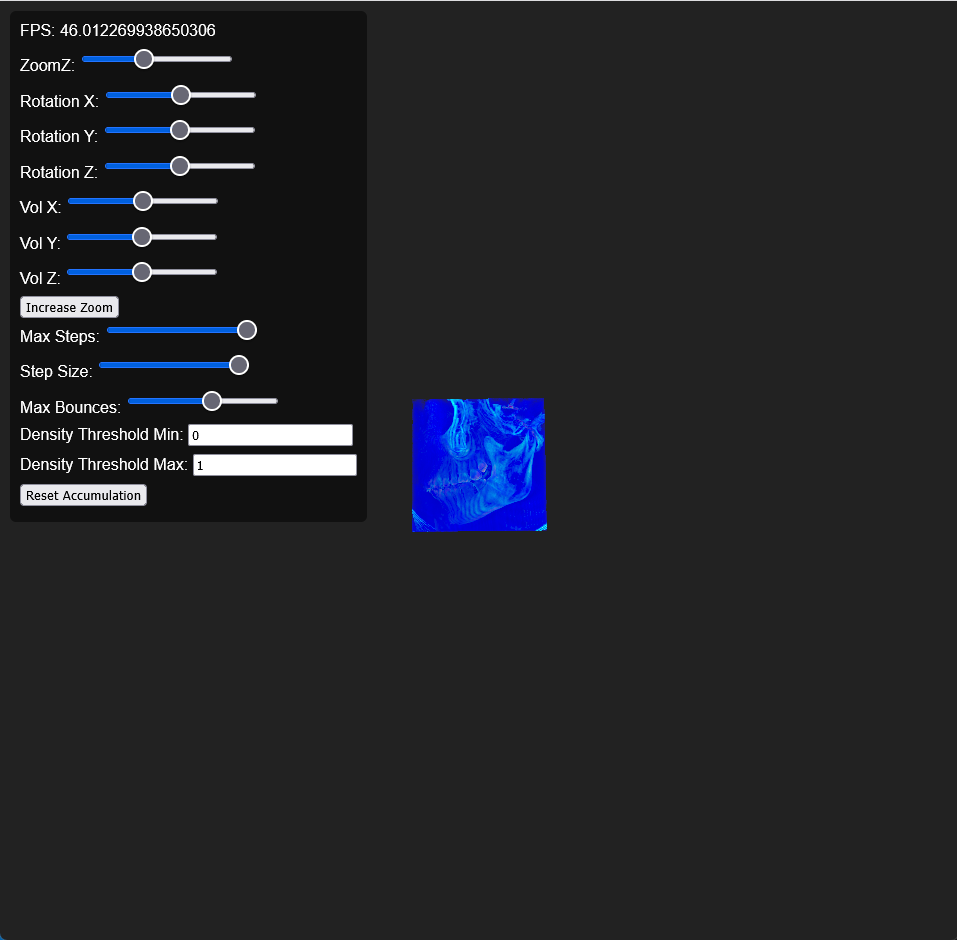
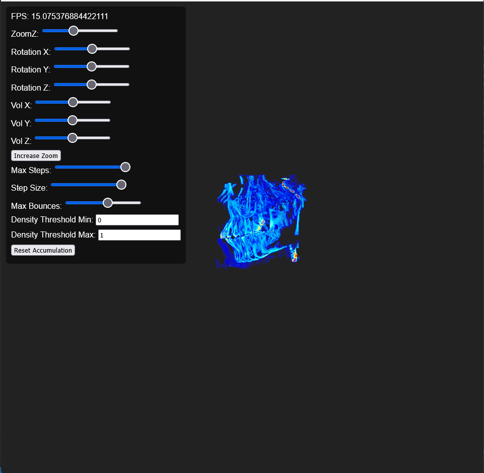
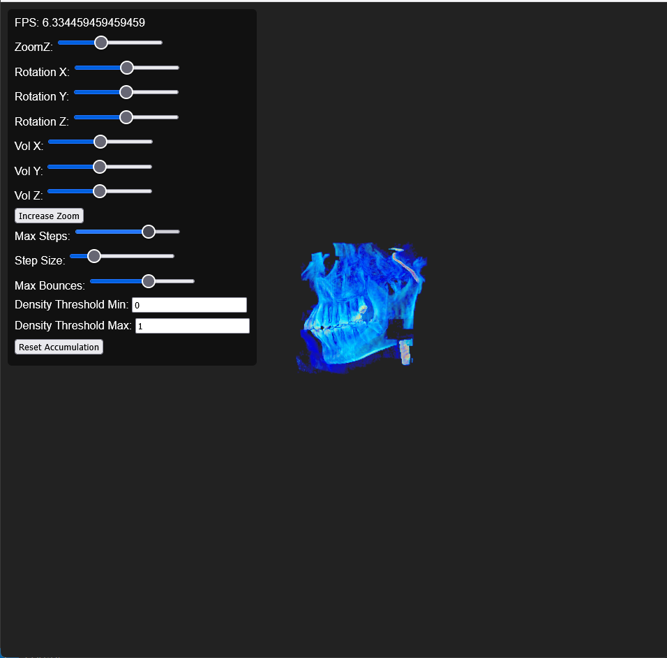
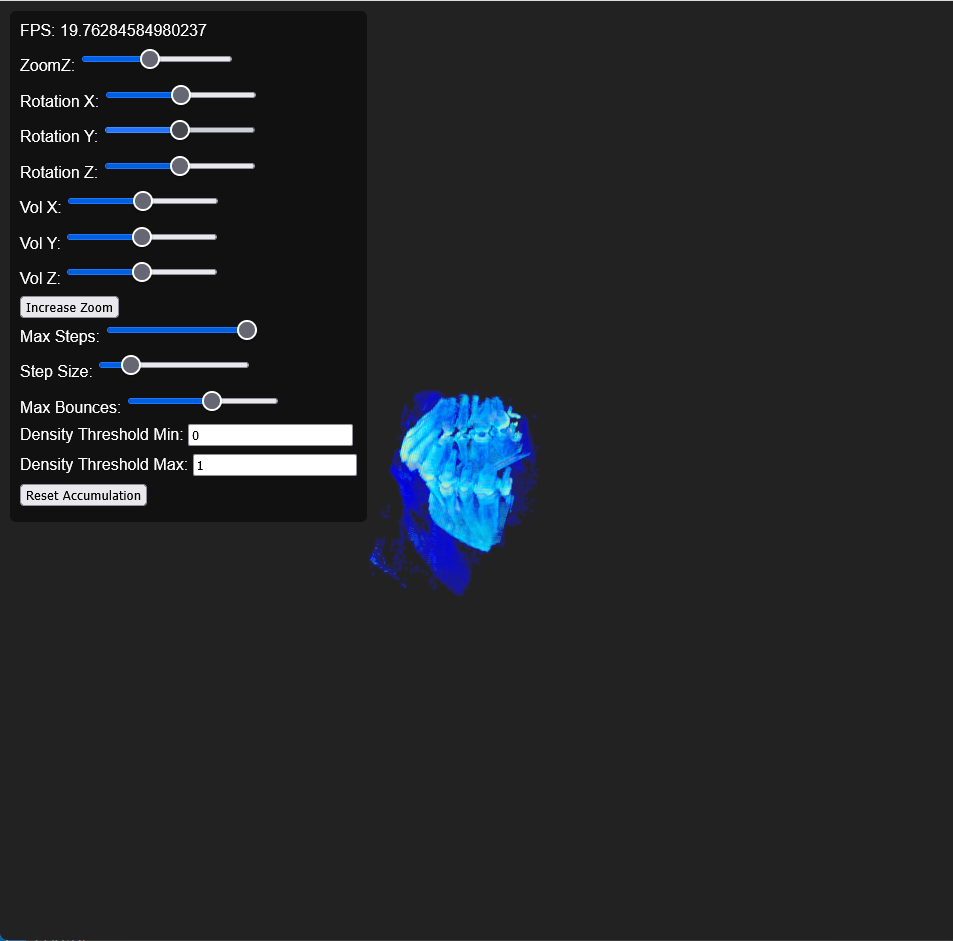

# VolumeSegmenter: Intelligent 3D Volume Segmentation for WebGL Rendering

  

VolumeSegmenter is a specialized tool designed to solve the challenge of rendering large 3D volume data in WebGL environments. It intelligently segments large volumetric datasets into smaller, meaningful components while preserving critical structural information.

## Problem Solved

Large 3D volumes (e.g., medical CT/MRI scans) present significant challenges for WebGL rendering:
- **Memory constraints**: Volumes larger than 100MB often exceed browser memory limits
- **Rendering performance**: Single large volumes cause significant frame rate drops
- **Network loading time**: Large files take too long to transfer and initialize
- **Quality degradation**: Simple downsampling loses important structural details
- **Partial render key component**: Focus on the interest part of the voume

### Result
Originally `skull_256x256x256_uint8.raw` is about __16 MB__, but after the extraction, we can achieve about __6 MB__

Original Volume Rendering Result

Extract Volume Rendering Result

Extract Volume Rendering With Reduce Step Size Result

Extract Volume Partial Rendering Result

VolumeSegmenter addresses these issues by:
- **Splitting** large volumes into 4-16 anatomically meaningful sub-volumes
- **Controlling** file sizes to 5-15% of the original volume per component
- **Preserving** critical structural integrity and spatial relationships
- **Optimizing** outputs for direct WebGL consumption

## Core Approach

### Adaptive Background Separation
Automatically identifies and removes background regions without manual thresholding. Uses K-means clustering to determine optimal background intensity thresholds based on data distribution, ensuring foreground structures remain intact.

### Spatial-Intensity Balanced Segmentation
Intelligently balances spatial connectivity and intensity similarity when grouping voxels:
- **Spatial priority**: Ensures physically connected structures remain unified even with intensity variations
- **Intensity sensitivity**: Separates distinct structures even when spatially adjacent
- **Dynamic weighting**: Automatically adjusts the balance based on data contrast characteristics

### Multi-stage Component Generation
Creates anatomically meaningful components through:
- **K-means clustering**: Efficiently groups voxels without memory-intensive algorithms
- **Region growing**: Expands clusters to ensure spatial continuity
- **Guaranteed component count**: Ensures 4-8 meaningful components regardless of input complexity
- **Fallback mechanisms**: Creates grid-based components when algorithmic segmentation fails

### Intelligent Size Optimization
Automatically optimizes component sizes for WebGL rendering:
- **Adaptive downsampling**: Reduces resolution only when necessary based on volume size
- **File size control**: Limits each component to user-specified maximum size
- **Spatial mapping**: Accurately maps segmented components back to original coordinate space
- **Memory efficiency**: Processes volumes up to 1GB with less than 2GB RAM usage

## Input Requirements

- **Format**: Raw binary volume files (.raw)
- **Data type**: Unsigned 8-bit integers (uint8)
- **Dimensions**: Any 3D size (e.g., 128×128×128, 256×256×256, 512×512×128)
- **Content**: Medical imaging, scientific data, or any 3D volumetric dataset

## Output Format

- **File format**: Individual .raw files for each segmented component
- **Naming convention**: `component_{index}_{size_x}x{size_y}x{size_z}_{trans_x}x{trans_y}x{trans_z}_0.0x0.0x0.0.raw`
  - `size_x,y,z`: Component dimensions in voxels
  - `trans_x,y,z`: Translation coordinates in original volume space
  - `0.0x0.0x0.0`: Rotation values (currently not used)

- **Metadata**: JSON file containing processing parameters and component information
- **Component count**: Guaranteed 4-8 meaningful components per volume

## Performance Characteristics

| Volume Size | Peak Memory | Processing Time | Output Components | Total Output Size |
|-------------|-------------|-----------------|-------------------|-------------------|
| 128³ (2.1MB) | <500MB | ~12 seconds | 4-6 | 1.5-2.5MB |
| 256³ (16.8MB) | <1.2GB | ~38 seconds | 6-8 | 8-12MB |
| 512³ (134.2MB) | <1.8GB | ~2 minutes | 8-12 | 60-80MB |

## WebGL Integration Benefits

- **Faster loading**: Smaller files load progressively
- **Lower memory footprint**: Components can be loaded/unloaded as needed
- **Improved performance**: Rendering smaller volumes increases frame rates
- **Progressive detail**: Load lower-resolution components first, then higher-detail ones
- **Direct compatibility**: Output format works with standard WebGL volume rendering libraries

## Typical Use Cases

- **Medical visualization**: Rendering high-resolution CT/MRI scans in web browsers
- **Scientific data exploration**: Interactive analysis of large simulation datasets
- **3D content delivery**: Web-based volumetric content for education and research
- **Telemedicine applications**: Remote viewing of medical imaging studies

VolumeSegmenter transforms large, unwieldy 3D volumes into WebGL-friendly components without sacrificing critical structural information, enabling high-quality interactive 3D visualization in web environments.

### Files
`extractVolume.py` is used to cut the volume in pieces and able to render with `webgl_volume_rendering.html`

I purposely use html and JS to reduce the barrier across platform. As long as the device support webgl, should be able to render with extracted volume.

### How to use
To extract the volume, you need to run
`python .\extractVolume.py --input .\skull_256x256x256_uint8.raw --output ./skull --shape 256 256 256`

and this will give you the extract files in target folder

Then to render volumes (WebGL can handle 16 volumes at most at the same time)

you need to update the settings in `main()`, 

for example to update `volumeTexture1` for loading the volume,

update `volumeTextures` for targeting volumes

and update `volumeInfos` for target volume information. Just keep in mind that the generated file is having format as `component_1_{x}x{y}x{z}_{pos_x}x{pos_y}x{pos_z}_{rotate_x}x{rotate_y}x{rotate_z}.raw`

and for `pos` in `volumeInfos`, needs to be `[pos_x/-2, pos_w/-2, pos_z/-2]`