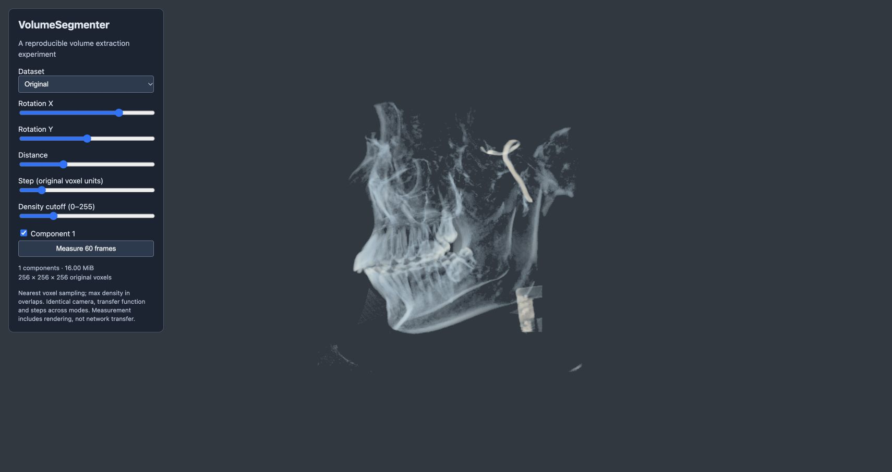
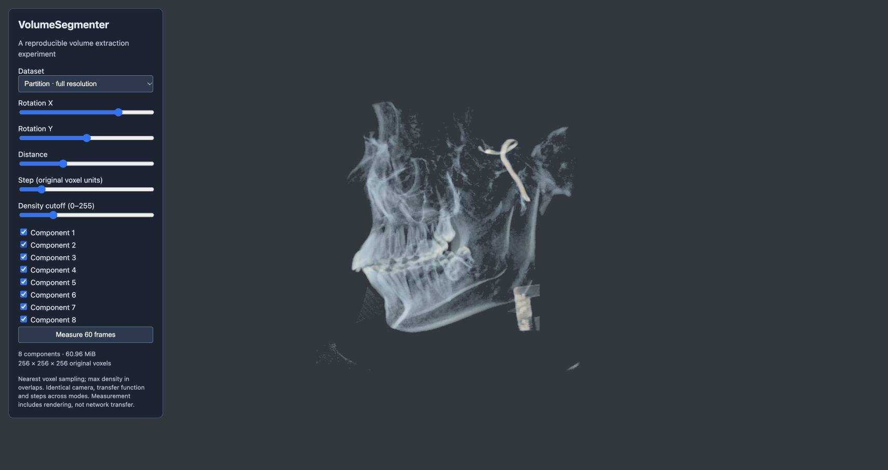
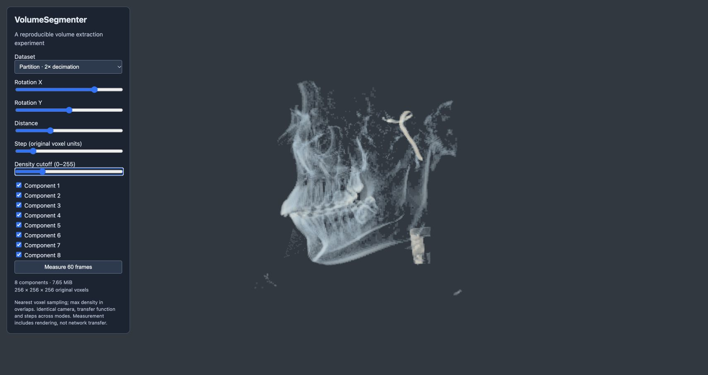
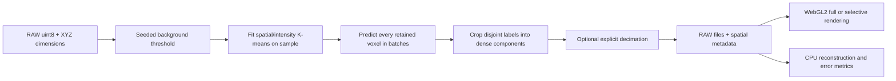

# VolumeSegmenter

An end-to-end proof of concept for extracting spatially mapped components from 3D uint8 volumes and rendering them independently in WebGL2.

The question is whether background removal, component extraction and explicit spatial metadata can form a usable browser rendering pipeline—and what data-size and quality trade-offs this introduces. This is an engineering feasibility study, not an anatomical segmentation model or a medical application.

## What the experiment shows

The original skull experiment produced **5.85 MiB from 16 MiB (63.5% smaller)**. Its code, metadata and file hashes are preserved under [experiments/legacy](experiments/legacy); the original component files remain in `skull/`. That result includes thresholding, morphological filtering and downsampling. It is not a lossless compression ratio.

The corrected pipeline predicts a label for **every retained voxel**, exports coordinates and sampling spacing, and renders every component. The full-resolution reconstruction exactly matches the thresholded input on the included skull dataset. However, K-means partitions have overlapping bounding boxes containing zeros: writing each as a dense RAW array can increase storage substantially. Independent component rendering works; universal storage or rendering improvements are not established.

### Controlled skull experiment

256 × 256 × 256 uint8; threshold 13.621871; seed 42; eight clusters; spatial weight 0.5. MiB means 1,048,576 bytes. Results are raw payload sizes, excluding metadata and HTTP compression.

| Variant | Output MiB | Reduction vs input | MAE vs thresholded input | Missing retained voxels |
| --- | ---: | ---: | ---: | ---: |
| Original | 16.00 | 0% | 0¹ | 0 |
| Background + whole bounding box | 16.00 | 0% | 0 | 0 |
| Full-resolution partitions | 60.96 | −281.0% | 0 | 0 |
| Partitions + 2× decimation per axis | 7.65 | 52.2% | 4.40 | 1,404,051 |
| Whole bounding box + 2× decimation | 2.00 | 87.5% | 4.24 | 1,326,794 |

¹ The original row is compared to the original input. All processed rows use the same thresholded reference. MAE is measured over the entire original voxel grid in uint8 intensity units. The JSON report also includes error against the original input, introduced nonzero voxels and overlaps.

**Interpretation:** the current partitioning scheme enables selective display, but it does not beat simple decimation in size or reconstruction error on this dataset. Downsampling is a major contributor to size reduction. These negative results are part of the feasibility study, not hidden by choosing only the smallest output.

[Machine-readable extraction report](experiments/results/skull-report.json) includes the input hash, environment, exact bytes, metrics and single-run processing times. These timings are illustrative, not statistical throughput claims. No peak-memory or network-transfer improvement is claimed.

### Matched rendering comparison

Same camera (X=90°, Y=0°, distance=1.8), step=1 original voxel unit, density cutoff=60, viewport and transfer function. Nearest sampling makes the mapping explicit; this cutoff hides low-density differences, so the numerical reconstruction metrics above remain essential.

| Original | Full-resolution partitions | Decimated partitions |
| --- | --- | --- |
|  |  |  |

Rendering measurements and verification details are in [experiments/results/VALIDATION.md](experiments/results/VALIDATION.md).

## Reproduce

Python 3.12+ and a WebGL2-capable browser are required. The recorded environment used Python 3.13.7 on macOS ARM64. The viewer has no npm dependencies or build step.

```bash
python3 -m venv .venv
source .venv/bin/activate
pip install -r requirements-lock.txt
python -m unittest discover -s tests -v
python benchmark.py
python -m http.server 8765 --bind 127.0.0.1
```

On Windows, activate with `.venv\Scripts\activate`. Open [the local viewer](http://127.0.0.1:8765/webgl_volume_rendering.html) after the benchmark finishes. It generates five variants under `experiments/current/`, which is ignored by Git. Generated outputs are intentionally not duplicated in the repository. Existing results are never silently overwritten: for a rerun, use a fresh directory:

```bash
python benchmark.py --output experiments/run2
```

Then open `webgl_volume_rendering.html?base=./experiments/run2/`. `requirements.txt` specifies compatible ranges; `requirements-lock.txt` records the tested versions. Pinning versions and limiting numerical libraries to one thread improves repeatability; bitwise equivalence across different platforms/library versions is not promised.

The schema-2 CLI replaces legacy `--max-components`, `--min-ratio` and `--max-ratio` controls with explicit `--components` and `--downsample` settings. It does not silently force a component count or file-size target. The old `UniversalVolumeSegmenter` class is preserved only in the legacy source.

### Process another volume

```bash
python extractVolume.py --input input.raw --shape 320 240 128 \
  --output experiments/custom --components 8 --seed 42 \
  --spatial-weight 0.5 --downsample 1
```

`--shape` is **X Y Z**. Files must contain exactly X×Y×Z bytes, uint8, X varying fastest. The NumPy array is Z,Y,X in C order. `--threshold 20` overrides the automatic intensity threshold. `--downsample 2` keeps every second voxel along each axis, without anti-aliasing; it is explicitly lossy and can remove thin structures. Use `--mode crop` for a single foreground bounding box, or `--mode original` for the unthresholded baseline.

Open `webgl_volume_rendering.html?manifest=./experiments/custom/metadata.json` to load custom output. The mode selector is disabled for a custom manifest. Component checkboxes control visibility; all components are currently downloaded and kept resident, so this does **not** implement streaming or GPU-memory savings from unloading.

## Pipeline and design



- K-means explores spatial/intensity grouping without claiming semantic or anatomical regions. Features are standardized **before** applying their weights; weights therefore have an effect.
- Sampling limits the training set to 30,000 foreground voxels. Prediction covers all retained voxels in batches; unsampled points are not dropped.
- Each retained voxel has one label before decimation. The implementation avoids dilation and synthetic extra components, which previously obscured coverage and overlap. Empty input produces zero components.
- Dense component bounding boxes may overlap even when their nonzero voxels are disjoint. Decimation followed by block reconstruction can introduce nonzero overlaps; CPU and GPU both merge these using maximum intensity. Metrics report them explicitly.
- The viewer uses a deterministic, single-pass front-to-back emission/absorption ray march, starting at the whole-volume ray entry. It does not use the old frame accumulation or claim physical path tracing. Every supported sampler has a branch, and texture limits are checked.

### Metadata contract (schema 2)

All spatial metadata is XYZ, in original voxel units. There is no physical millimeter spacing or rotation support in this version.

```json
{
  "schema_version": 2,
  "dtype": "uint8",
  "dimensions_xyz": [320, 240, 128],
  "components": [{
    "file": "component_1.raw",
    "dimensions_xyz": [5, 4, 4],
    "origin_xyz": [4, 3, 2],
    "spacing_xyz": [2, 2, 2],
    "extent_xyz": [9, 7, 7]
  }]
}
```

`extent_xyz` is the exclusive original-space extent, **not** the stored sample count. The last reconstructed block is clipped to that extent. A world point `p` inside the component maps to sample index `floor((p - origin) / spacing)`. This convention is shared by the CPU reconstruction and nearest-sampled renderer. The real manifest also includes byte counts, hashes, parameters and processing time.

## Scope and limitations

- One real dataset and synthetic correctness fixtures have been tested; generality across CT/MRI or scientific datasets is unproven.
- Background estimation is an intensity heuristic, not a guarantee of structural preservation. No morphology is applied in the corrected path; its output is intentionally different from the legacy experiment.
- The extractor loads the full input and allocates foreground indices and labels. It is not an out-of-core solution and has no verified RAM ceiling for large inputs.
- At most 15 components are supported by this viewer, further limited by device texture capabilities. This is an implementation constraint, not a universal WebGL limit. Rays are limited to 8,192 steps.
- Nearest sampling and naive decimation prioritize a clear reference implementation over visual smoothness. Quality improvements need separate, controlled measurements.
- Next experiments: spatial bricks versus K-means, lossless byte compression, more datasets, and actual selective loading. None are claimed as completed.

## Repository map

- `extractVolume.py`: extraction, schema generation and CPU reconstruction.
- `benchmark.py`: five controlled extraction variants and metrics.
- `viewer.js` / `webgl_volume_rendering.html`: metadata-driven WebGL2 viewer.
- `tests/test_pipeline.py`: exact reconstruction, boundaries, non-cubic coordinates, empty/tiny data, coverage beyond the training sample, weights and reproducibility.
- `experiments/results/`: measured results and screenshots.
- `experiments/legacy/`: unmodified historical source, README, metadata and inventory. Legacy relative asset URLs expect the old repository-root layout; use Git revision `01fcf00` to run that version directly.

The included skull data and historical images predate this revision. No new dataset provenance or license grant is asserted here; the earlier README's MIT badge did not have a corresponding license file.
