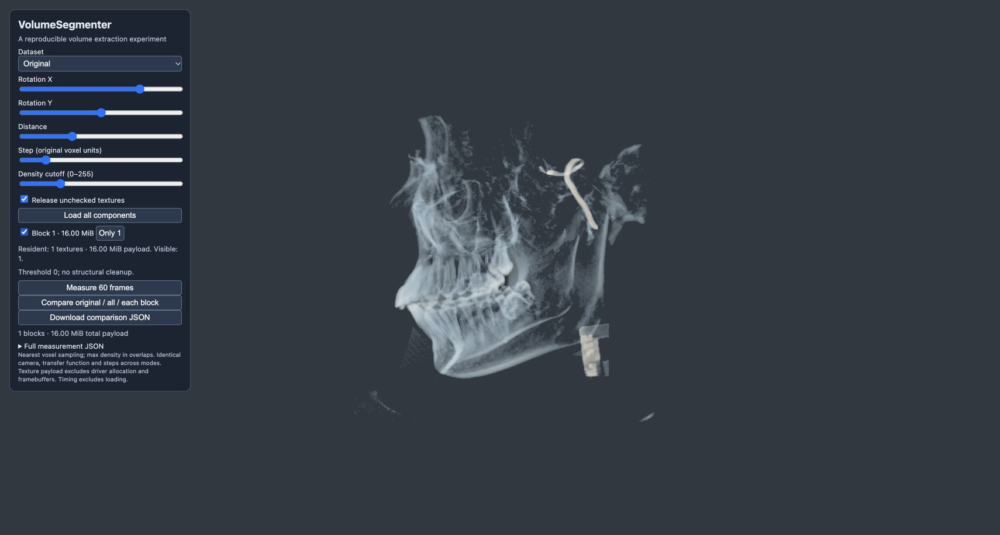
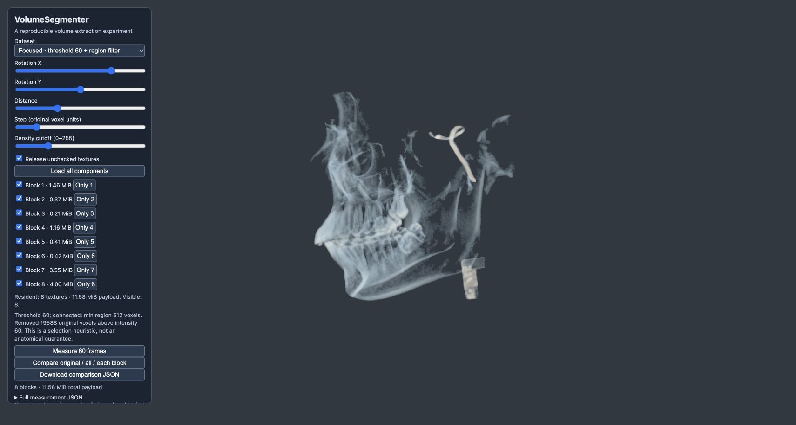

# Foreground selection and local cropping

All full-resolution variants use the same 256³ uint8 input and at most eight disjoint local boxes. Threshold and connected-region size are explicit selection heuristics. No anatomical labels or ground truth are available.

| Variant | RAW / R8 payload (MiB) | Reduction | Original >60 voxels retained | Original >120 voxels retained |
| --- | ---: | ---: | ---: | ---: |
| original | 16.000 | 0.00% | 100.000% | 100.000% |
| threshold | 16.000 | 0.00% | 100.000% | 100.000% |
| legacy_cleanup | 14.408 | 9.95% | 90.376% | 88.869% |
| opening | 15.686 | 1.96% | 99.866% | 99.859% |
| conservative | 14.427 | 9.83% | 99.947% | 99.986% |
| focused | 11.578 | 27.64% | 96.107% | 99.828% |
| aggressive | 6.457 | 59.65% | 23.187% | 99.822% |
| focused_decimated | 1.454 | 90.91% | 96.107% | 99.828% |

Survival percentages measure selection before decimation, not final decimated quality. High-intensity survival is only a proxy: the aggressive preset loses 76.81% of voxels above 60 despite retaining most voxels above 120. It must not be presented as equivalent-quality compression.

Every full-resolution variant reconstructs its selected reference exactly, with zero overlapping nonzero voxels. This does not mean equality to the original: selection deliberately removes data. The decimated control additionally has MAE 0.956 against the selected reference and does not reconstruct it exactly.

Each block stores its own tight bounding box and original-space origin. Zeros inside that box still occupy bytes in dense RAW files and R8 textures. Removing voxels only saves storage when it shrinks boxes or eliminates a block; there is no claim that storage equals the count of nonzero voxels. The eight-box heuristic is not a global optimum.

Connected filtering uses six-neighbor connectivity and preserves entire surviving regions. Conservative uses threshold 30/minimum 512; focused uses 60/512; aggressive uses 90/128. Opening uses the automatic threshold followed by 3³ opening and minimum 512. Legacy audits border removal and erosion; it does not reproduce historical 5.85 MiB files with missing spacing metadata.

Reproduce: `python foreground_study.py --output experiments/foreground`, then serve the repository and open `webgl_volume_rendering.html?study=foreground`. The saved [report](report.json) includes the input hash, environment, parameters, counts and reconstruction checks. Payload excludes JSON metadata, driver overhead and framebuffers. Previous spatial timing results do not measure these new filtered presets.

Browser check: all focused blocks render together at their original positions; selecting only block 1 releases the others and reduces resident payload from 11.58 MiB to 1.46 MiB. Screenshots use identical camera and cutoff 60; this display threshold hides discarded low-intensity data and is not a full fidelity test.

