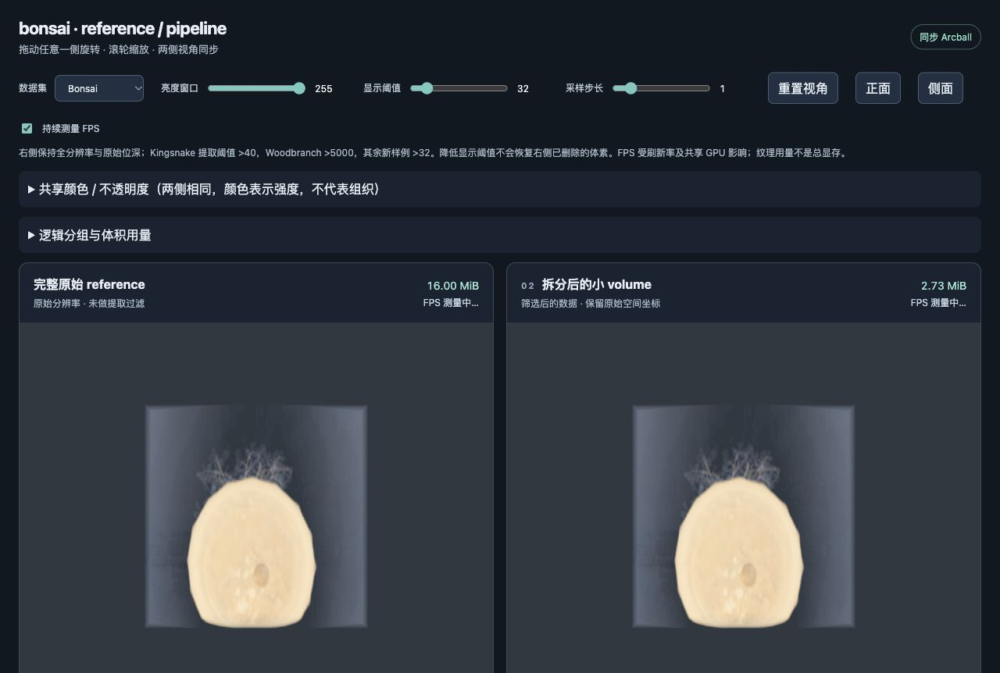

# Grouped-volume comparison

Measured locally on Apple M4 / 16 GiB unified memory. This report supersedes the old threshold-7000 Woodbranch comparison for the new grouped viewer.

All rows use full-resolution uint8/uint16 input, 16³ grid bricks, the same three fixed camera views, 640×480, step 1, nearest-neighbor sampling, and the shared color/opacity transfer function. Each mode/view has five warmups and 20 asynchronous GPU timer queries. The table is the median of the three per-view medians, not a screen-FPS estimate. Raw samples, windows, environment and per-view framebuffer differences are saved in the adjacent JSON files. Modes are sequential, not simultaneous. Upload, download, hashing and preprocessing are excluded from GPU timings.

| Dataset | Original MiB | Combined files MiB | Reduction | GPU MiB | Original / combined GPU ms | Image checks |
| --- | ---: | ---: | ---: | ---: | --- | --- |
| bonsai | 16.00 | 2.65 | 83.5% | 2.73 | 3.41 / 3.23 | 3/3 exact |
| foot | 16.00 | 4.08 | 74.5% | 4.14 | 3.55 / 3.99 | 3/3 exact |
| engine | 8.00 | 1.72 | 78.5% | 1.80 | 1.96 / 4.01 | 3/3 exact |
| kingsnake | 795.00 | 360.39 | 54.7% | 362.06 | 8.47 / 9.65 | 3/3 exact |
| woodbranch | 16384.00 | 719.48 | 95.6% | 745.94 | not run / 11.78 | MIP only; no full DVR reference |

## Selection and interpretation

Bonsai (plant CT), Foot (human foot scan), and Engine (industrial CT) add three small, independently sourced examples (16, 16 and 8 MiB). These broaden content coverage; they are not additional large-memory stress tests. Their input SHA-512 hashes match the Open SciVis catalog. Credits and download URLs are in the provenance files.

The three new examples use raw intensity >32, Kingsnake >40, Woodbranch >5000. These are explicit exploratory foreground rules, not anatomical or semantic ground truth. The color transfer function uses blue/orange/cream control points at 0/50/100% of the recorded display window, with extinction coefficients 0.0001/0.003/0.06. Original and combined representations use identical settings within each row.

Exact image checks apply only to that display cutoff and those three cameras. They do not prove the removed data was irrelevant. Unfiltered-versus-thresholded projection differences are reported separately. Woodbranch retains 211,046,399 voxels (2.46%), versus 92,042,622 at the earlier >7000 cutoff. That is 2.29× as many retained samples, but substantial lower-intensity structure is still omitted.

Woodbranch's 16 GiB monolithic texture is skipped before allocation by the 1 GiB experiment budget. There is no observed OOM or measured original GPU time for that row. Three full-resolution thresholded MIPs and every decoded grouped brick are verified instead. The online image in the viewer is only an external appearance reference.

## Logical groups and memory

Each brick is assigned to an intensity band using the median of its selected voxels. Six-neighbor bricks in the same band form components. The nine largest components remain separate; smaller components are explicitly pooled by band. Group names describe brick medians, not the exact range of every voxel within the group. This is a brick graph baseline, **not cross-chunk SLIC or tissue classification**. A connected brick graph does not guarantee voxel-level connectivity.

Every brick belongs to exactly one group. Logical AABBs reference their members; no dense parent volume is allocated. The automatic encoder selects dense crops or 32-voxel occupancy masks according to smaller total value+mask bytes. Occupancy masks remove stored interior zeros without deleting additional selected voxels. Original precision and coordinates are retained.

“Combined files” sums group sample payloads, masks and group indices; it excludes small JSON manifests and the optional retained source/baseline files on disk. GPU payload adds the resident dense page table, row/layer padding and dummy textures, but excludes browser/driver overhead. Thus the storage and GPU columns intentionally differ. All-group totals count each brick once.

The UI displays each group's bytes and supports multiple selections. It releases old textures and rebuilds only selected groups. On Woodbranch, all groups use about 745.94 MiB, the largest connected group about 350.50 MiB, and no selected groups still retain the 32 MiB page table. This is selection-based residency, not demand streaming or a cache. Small groups may remain dominated by page-table overhead.

## Reproduce

See [the guide](../../docs/LARGE_VOLUMES.md). Run the exporter/grouping/verification commands, start the HTTP server, and use the standalone viewer's color preset “内部结构彩色” and benchmark button for each grouped manifest. Save the JSON reports here as `<dataset>-rendering.json`, then run `python -m pipeline.summarize_grouped_results`.

The comparison page dataset selector exposes all five grouped datasets plus the existing Skull path. The original Skull SLIC experiment remains a separate algorithm baseline.

## Visual checks

The interactive screenshot uses the surface preset for visibility; benchmark JSON records the internal-structure preset used for timing.

[bonsai projection comparison](bonsai-projections.png) · [foot projection comparison](foot-projections.png) · [engine projection comparison](engine-projections.png) · [kingsnake projection comparison](kingsnake-projections.png) · [woodbranch projection comparison](woodbranch-projections.png)
