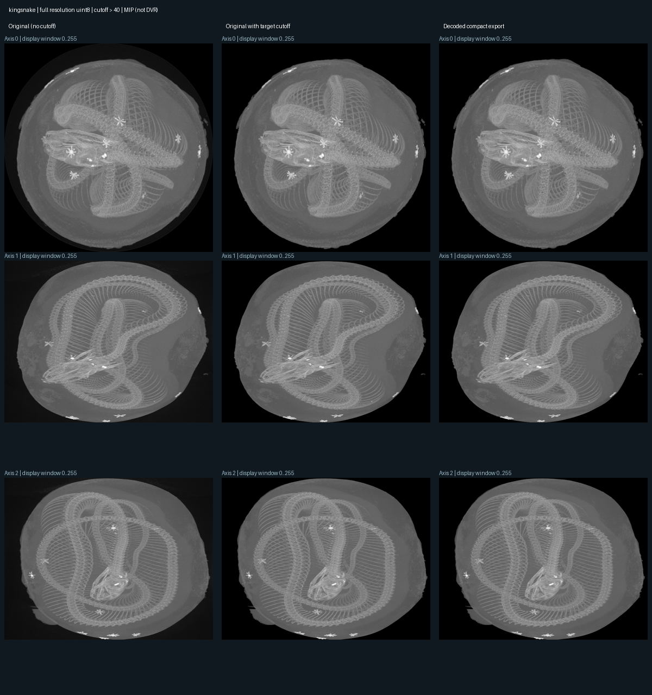
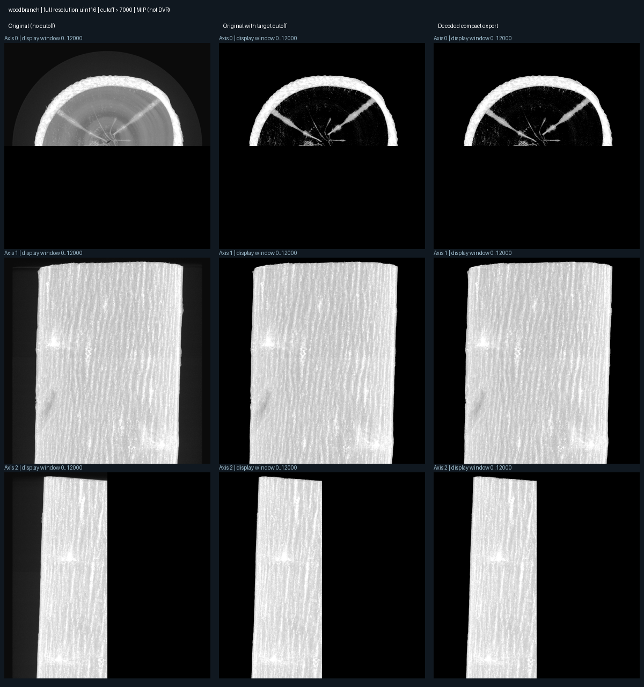

# Full-resolution compact volume experiment

Measured on Apple M4 (10-core GPU), 16 GiB unified memory. Raw GPU samples and browser limits are retained in the adjacent rendering JSON files. Each value below is the median of 20 queries after five warmups, at 640×480, step 1, in three fixed views. Modes run sequentially with alternating order; timings exclude preprocessing, download, upload and hashing.

| Dataset | Representation | Resident texture payload | GPU ms, views 1 / 2 / 3 |
| --- | --- | --- | --- |
| Kingsnake | original | 795.00 MiB | 3.39 / 6.79 / 5.49 |
| Kingsnake | compact | 362.06 MiB | 3.21 / 3.12 / 4.52 |
| Woodbranch | original | Skipped (16 GiB input) | Not measured |
| Woodbranch | compact | 372.53 MiB | 3.81 / 3.94 / 5.21 |

Kingsnake reduces texture payload by about 54.5%. All three tested framebuffers match exactly between full and compact rendering with cutoff 40. The full 795 MiB volume **does render on this machine**. Compact rendering was faster in these views; this is not a universal speed guarantee.

Woodbranch reduces 16 GiB of raw source samples to 340.52 MiB of tightly cropped samples plus 32 MiB of page-table storage and small texture padding: about 97.7% less texture payload. The full texture was rejected by the experiment's 1 GiB budget **before allocation**, not observed to OOM. Three complete orthogonal MIPs match the thresholded source exactly. There is no full-resolution original DVR framebuffer comparison for Woodbranch.

## What was preserved, and what was removed?

Both exports use full spatial resolution and original uint8/uint16 values. Kingsnake retains 43.65% of input voxels (value >40); Woodbranch retains 1.07% (>7000). Cropped boxes can include zero-valued holes, which explains why payload reduction is less than selected-voxel reduction. This is explicitly lossy target selection, not lossless compression of all source information.

**The Woodbranch threshold is very restrictive.** Its unfiltered reference MIPs differ in 775,165–1,814,659 pixels per 2048² projection. We have not established that those discarded structures are unimportant. Exact target preservation is not evidence of semantic quality or near-equivalence to an unfiltered original.

The independent verifier checks payload hashes, crop bounds, contiguous payload intervals, selected intensity histograms and all three MIPs. Kingsnake also checks every stored crop against original RAW. Three original-RAW HTTP voxel reads independently spot-check Woodbranch's OME source mapping; they are not whole-source verification. The synthetic uint16 skull fixture additionally checks anisotropic spacing and 16-bit GPU fetches.

## Preprocessing and limitations

- Kingsnake: 7.98 seconds, peak process RSS 236.38 MiB; excludes prior RAW download.
- Woodbranch: 791.63 seconds, peak process RSS 310.45 MiB; includes streaming about 5.55 GB of compressed chunks.
- GPU figures are allocated sample/page payload, not total driver, browser or CPU memory.
- The renderer uses nearest-neighbor samples and one packed 2D array texture. Selection must fit its 1 GiB budget. There is no runtime paging or LOD cache.
- This experiment is intensity-based. SLIC across source chunks and automatic semantic grouping are not implemented here.
- Next useful experiment: sweep target thresholds against reference image quality and memory, then replace intensity-only selection with spatially coherent candidates. Preserve the same exact-value and coordinate checks.

See [reproduction commands](../../docs/LARGE_VOLUMES.md). Large input/export files are ignored by Git; measurements and figures are versioned.
