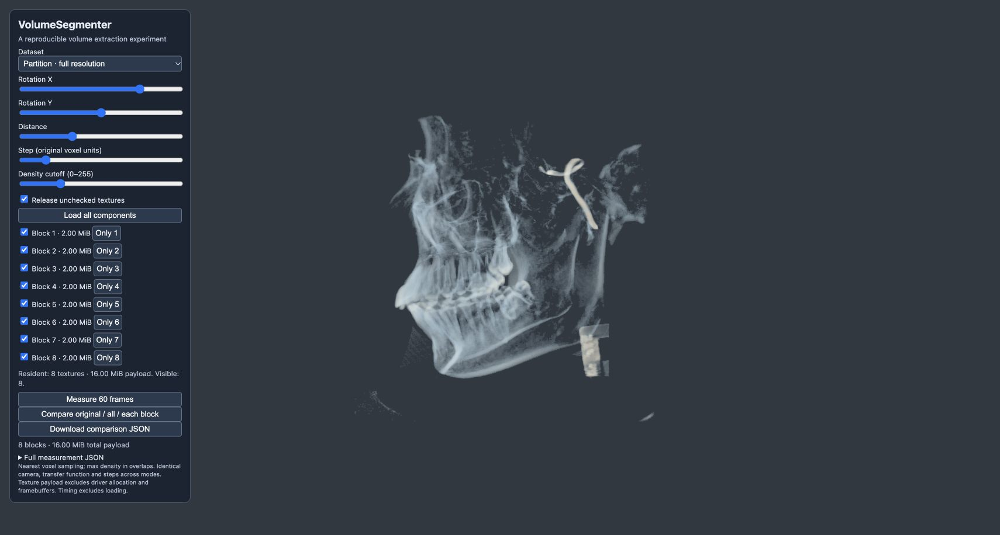
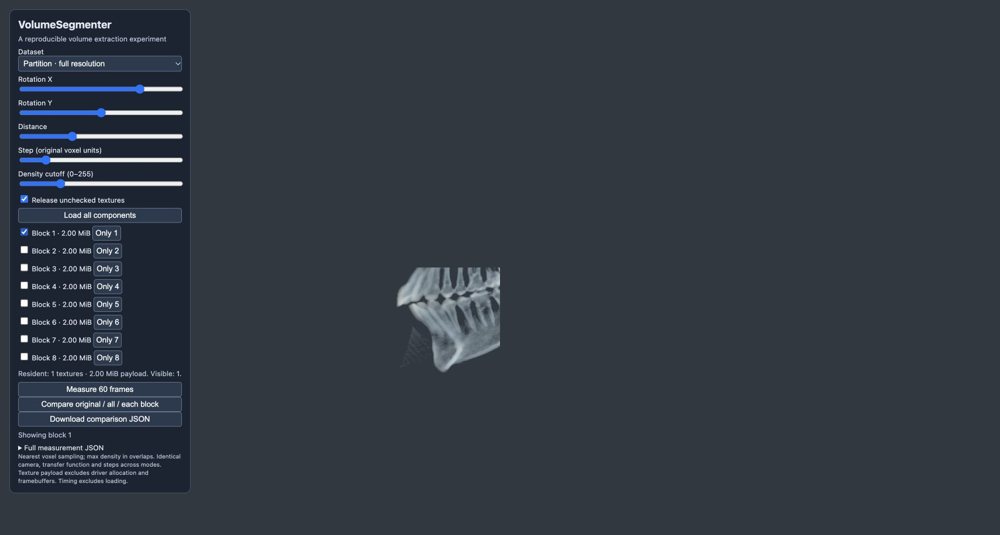

# Spatial block experiment — 2026-10-19

## Question and setup

Compare original monolithic rendering, simultaneous rendering of all full-resolution blocks, and each block separately. The extractor now uses nonoverlapping spatial boxes, each tightly cropped and stored at its own local dimensions plus original-space origin. No decimation is used in this rendering experiment.

The included skull produces eight 128³ blocks: 2 MiB each, 16 MiB total. Its low-intensity foreground reaches the spatial boundaries, so tight cropping cannot remove those boundary voxels at the default threshold. This is an equal-size full-resolution representation, not a new full-volume compression result. The CPU reconstruction exactly equals the thresholded input, with zero missing, introduced or overlapping nonzero voxels. [Extraction report](extraction.json).

## Measurements

[Full raw samples and settings](rendering.json). The earlier completed pass is retained as [initial-summary.json](initial-summary.json): its original-volume median was 5.02 ms versus 8.25 ms in the final export pass, while all-block medians were 10.39 and 9.75 ms. This variability means the exact all-versus-original speed ratio is not a stable hardware claim. Single-block times and payload reduction were consistent in direction across both passes.

1280×720 drawing buffer; camera 90°, 0°, distance 1.8; step 1; display cutoff 60. Three seeded-shuffled rounds, five warm-ups and 20 GPU timer-query samples per round/case. Upload and network time excluded. The screen-space size and camera stay fixed when selecting a block. Timings are specific to this device/view and vary across rounds.

| Case | Median GPU ms | Resident volume payload MiB |
| --- | ---: | ---: |
| original | 8.249 | 16.00 |
| all_blocks | 9.745 | 16.00 |
| block_1 | 1.566 | 2.00 |
| block_2 | 1.566 | 2.00 |
| block_3 | 2.201 | 2.00 |
| block_4 | 1.912 | 2.00 |
| block_5 | 1.418 | 2.00 |
| block_6 | 1.594 | 2.00 |
| block_7 | 2.551 | 2.00 |
| block_8 | 3.227 | 2.00 |
| block_1_hidden_others_resident | 1.635 | 16.00 |
| monolith_same_roi_1 | 1.644 | 16.00 |

Single-block rendering shows less content and is faster than displaying everything. Releasing the other seven textures reduces resident volume payload by **87.5%**. Hiding them without deleting textures produces similar rendering speed but keeps **16 MiB** resident.

The same-ROI monolithic control keeps a 16 MiB thresholded texture but clips rendering to block 1’s exact original-space box. Its GPU time is close to block 1’s, so this experiment does not establish a speed advantage for local texture storage over equally clipped monolithic rendering. The demonstrated difference is the **2 versus 16 MiB volume payload**.

All-block rendering still has extra per-ray and per-sample box checks and is slower than the original monolith. Do not compare these numbers directly to the earlier K-means report: the shader, bounding boxes and drawing-buffer resolution changed.

Memory is application-owned R8 voxel payload, not measured physical VRAM. The one-byte dummy texture, framebuffer/driver overhead and deferred driver reclamation are separate. Total physical GPU allocation is unknown. No out-of-core CPU memory claim is made.

## Verification

- Ten Python tests passed: non-cubic coordinates, tight bounds, disjoint boxes, payload budget, exact reconstruction, empty/tiny data, thresholding, decimation and K-means comparison behavior.
- Regenerating all five extraction variants produced identical component records and SHA-256 hashes.
- Browser controls verified all→one (16→2 MiB), hide-only (16 MiB with one visible), release hidden (2 MiB), and no selection (0 MiB volume payload).
- The comparison tests every block rather than selecting only the fastest.

| All blocks | One local block |
| --- | --- |
|  |  |

## Reproduce

Run `python benchmark.py`, start a local HTTP server, open the viewer and click **Compare original / all / each block**. Full measurement JSON is available in the expandable panel as well as the download control. See the root README for commands and parameter meanings.
