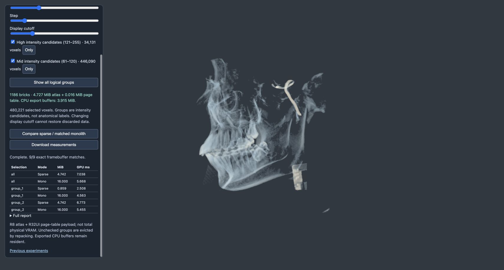
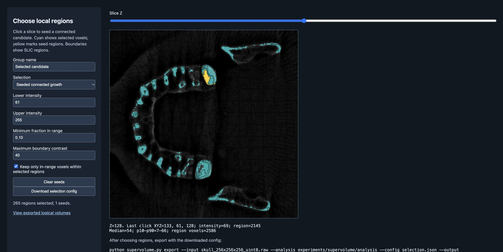

# SLIC logical volumes: implementation and measurements

This experiment implements intensity/spatial candidate grouping, explicit selection, and sparse storage of the selected result. It does not train or validate an anatomical classifier. Source, algorithm decisions and reproduction commands are in [the implementation guide](../../docs/SUPERVOLUMES.md).

## Selection evidence

The included 256³ uint8 input produced 4,225 SLIC regions and 30,219 face-adjacency edges in 12.45 seconds on this run. Default region scale=16, compactness=0.08, no smoothing, no decimation.

The demonstration selects two candidate groups: intensity 121–255 with region support ≥5%, and 61–120 with support ≥10%. It retains 480,221 voxels. These are intensity classes, not verified bone/skin/vessel labels. All original intensities ≤60 are discarded by this preset. It additionally removes 22,976 / 503,197 voxels above 60 (4.57%), including 1,339 / 35,470 above 120 (3.78%). This selection is not established as more anatomically accurate than the previous connected-component filter.

The seeded demonstration (region 1405; target61–255, support0.1, boundary contrast40) selects 265 regions / 446,652 voxels. The slice inspector was checked at XYZ133,61,128 (region2145): its 265-region preview agrees with Python for the same rule. These seeds reach the same connected candidate; they are not expert annotations.

## Storage of the SAME selected data

| Brick edge | Bricks | Cropped density MiB | Ownership MiB | JSON MiB | Complete export MiB |
|---|---:|---:|---:|---:|---:|
| 8 | 4975 | 1.106 | 1.106 | 0.761 | 2.973 |
| 16 | 1186 | 1.958 | 1.958 | 0.187 | 4.102 |
| 32 | 284 | 3.570 | 3.570 | 0.048 | 7.187 |

All three layouts reconstruct the identical selected uint8 field and ownership map exactly; the selected SHA256 is shared. Parent AABBs and the BVH are metadata only. Each voxel belongs to one group even when group bounds overlap. Tight file crops are padded back to fixed-size atlas slots on upload, so GPU bytes are larger than density file bytes. Ownership is retained on the CPU, not uploaded as another volume texture.

## Rendering

Each brick-size run uses the same shader and selected content for sparse and monolithic cases, three shuffled rounds, five warmups plus 20 timed frames per case, fixed 1280×720/camera90,0,1.8/step1/cutoff60. Times exclude loading, repacking, upload and analysis. Monolithic baseline reconstructs the selected data into the original 256³ grid, and uses the same selected-data bounding interval. GPU queries are not end-to-end frame-rate measurements.

| Brick edge | Selection | Sparse GPU ms | Matched mono GPU ms | Sparse atlas + page MiB | Mono + dummy page MiB |
|---|---|---:|---:|---:|---:|
| 8 | all | 6.445 | 3.709 | 2.656 | 16.000 |
| 8 | group_1 | 3.201 | 4.661 | 0.441 | 16.000 |
| 8 | group_2 | 4.281 | 3.552 | 2.656 | 16.000 |
| 16 | all | 7.038 | 5.668 | 4.742 | 16.000 |
| 16 | group_1 | 2.508 | 4.563 | 0.859 | 16.000 |
| 16 | group_2 | 6.773 | 5.455 | 4.742 | 16.000 |
| 32 | all | 9.265 | 4.317 | 9.189 | 16.000 |
| 32 | group_1 | 3.565 | 4.541 | 2.346 | 16.000 |
| 32 | group_2 | 9.221 | 6.259 | 9.189 | 16.000 |

Each size passed nine byte-identical GPU framebuffer comparisons (all, high group, mid group × three camera angles). There are 27/27 matching images across sizes, and 1,080 valid final GPU samples. This validates selected-data rendering, not fidelity to discarded original data. Nearest sampling and step1 are the validated settings.

The implementation is a memory win, not a general all-content speed win. At 16³, all groups use 4.742 MiB versus 16 MiB but render in 7.038 ms versus 5.668 ms. The small high-intensity group uses 0.859 MiB and renders in 2.508 ms versus 4.563 ms. At 8³, the complete export is 2.973 MiB and the all-group GPU texture payload is 2.656 MiB. Different size runs show substantial baseline variability; use their within-run controls, not cross-session speedup claims.

The initial 16³ implementation looked up the page at every sample. Its [initial report](rendering-initial.json) is retained as diagnostic evidence; final code caches lookup until the ray enters another cell. This improved the observed all-group time in this session but was not an interleaved A/B experiment. Full-array CPU repacking and atlas allocation remain limitations. Total GPU allocation/physical VRAM, peak CPU RAM and first-display latency were not measured.

## Rule sensitivity

The following sweep uses one 61–255 candidate group and unchanged SLIC regions. This differs from the two-group demo. It shows why no fixed support threshold should be marketed as guaranteed preservation of important structures.

| Minimum region fraction | Selected regions | Selected voxels | Removed original >60 | Removed original >120 |
|---|---:|---:|---:|---:|
| 0 | 767 | 503197 | 0 | 0 |
| 0.01 | 457 | 500147 | 3050 | 96 |
| 0.05 | 347 | 492685 | 10512 | 256 |
| 0.1 | 299 | 482942 | 20255 | 378 |
| 0.2 | 242 | 460878 | 42319 | 468 |

At support 0, this unseeded range-clipped rule is equivalent to the scalar threshold; SLIC contributes no further deletion. Seeded adjacency and/or nonzero support make region grouping affect selection. Higher support can remove legitimate thin/minority features. Use a seed preview and explicit task-specific criteria; add annotated masks before claiming tissue accuracy.

## Reproduce

`python supervolume_study.py --output experiments/supervolume/repeat` produces the analysis, all three exports and a sensitivity report from scratch. Point `sparse_volume.html?manifest=./experiments/supervolume/repeat/selected8/metadata.json` at each layout, then click Compare. This output is ignored by Git; raw datasets are not duplicated in the repository.

21 automated tests pass, including seeded drift prevention, overlap ownership, partial bricks, empty/full/non-cubic data and thin-feature preservation during packing. Browser shader compilation and console checks passed. Results remain a one-real-dataset PoC plus synthetic fixtures.

